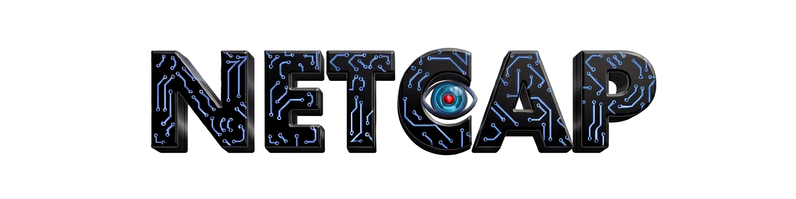
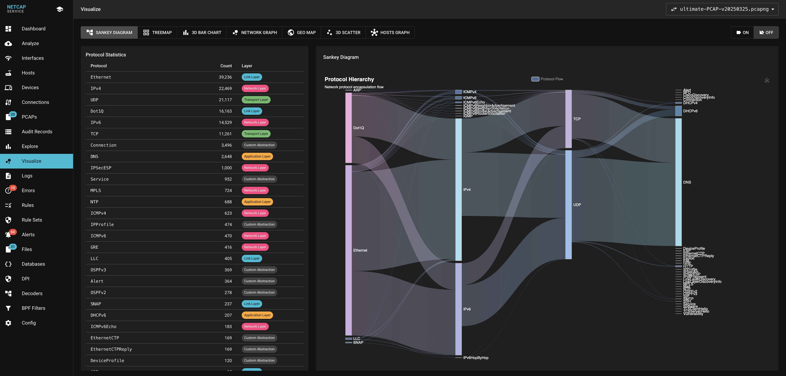

<p align="center">
  <a href="https://netcap.io">
    
  </a>
</p>

<p align="center">
  <a href="https://docs.netcap.io">Documentation</a> ·
  <a href="https://github.com/dreadl0ck/netcap/releases">Releases</a> ·
  <a href="docs/quickstart.md">First capture</a>
</p>

[](LICENSE)
[](https://go.dev)


[](https://godoc.org/github.com/dreadl0ck/netcap)
[](https://netcap.io)
[](https://docs.netcap.io)
[](https://app.fossa.com/projects/git%2Bgithub.com%2Fdreadl0ck%2Fnetcap?ref=badge_shield)
[](https://deepwiki.com/dreadl0ck/netcap)

**Netcap** (NETwork CAPture) converts live traffic and PCAP/PCAPNG files into structured Protocol Buffer audit records for security monitoring, forensic analysis and dataset preparation. The `net` CLI combines concurrent packet/stream decoding, investigation tools and a local web UI.

<a href="docs/GALLERY.md">
  
</a>

<p align="center"><em>Protocol hierarchy in the web UI — <a href="docs/GALLERY.md">more screenshots</a></em></p>

## Features

| Capability | Summary and details |
| --- | --- |
| Protocol analysis | Packet decoding and stream reassembly for network, application and OT/ICS protocols, including HTTP, TLS, DNS, SMB and S7Comm. [Coverage and limits](docs/protocol-support.md); [record schema](types/netcap.proto). |
| Analyst web UI | Record browsing, filters, protocol/host visualizations, alerts and investigation workspaces. [Web interface](docs/web-interface.md). |
| Security analysis | JA4 TLS ClientHello fingerprints (JA4+ requires an opt-in source build under separate terms), credential harvesting, file extraction, optional YARA-X scanning and Magika classification, plus software/CVE enrichment. [TLS](docs/tls-fingerprinting.md), [credentials](docs/credential-analysis.md), [files](docs/file-extraction.md), [vulnerabilities](docs/vulnerability-analysis.md). |
| Detection rules | YAML expressions, thresholds and sequences over audit records, including OT/ICS hunts. [Rule engine](docs/RULES_ENGINE.md); [S7 hunting](docs/s7-threat-hunt-AA26-231A.md). |
| Enrichment | DNS, GeoIP/ASN and MAC vendor lookups, with optional native DPI. [Resolvers](docs/resolvers.md), [DPI](docs/deep-packet-inspection.md), [database sources and updates](docs/database-updates.md). |
| Output and integrations | Protocol Buffers, CSV/JSON, Elasticsearch, Prometheus/Grafana, Maltego and Suricata/custom dataset labels. [Export](docs/filtering-and-export.md), [Elasticsearch](docs/elastic.md), [metrics](docs/metrics.md), [Maltego](docs/maltego-integration.md), [labeling](docs/audit-record-labeling.md). |
| Distributed capture | Remote agents deliver audit records over mutually authenticated TLS with acknowledgments and reconnects. [Distributed collection](docs/distributed-collection.md); [sealed offline sensor bundles](docs/sensor-bundles.md). |
| AI-agent access | Stdio MCP server for capture analysis and investigation. [MCP guide](docs/mcp.md). |

### Network detections

Capture-time scans, DNS anomalies, periodic connections and application-policy observations run alongside YAML rules. [Network detections](docs/network-detections.md) explains thresholds, indicator configuration and coverage; a match alone does not establish compromise.

### Hunting evidence

DNS transaction timing, DCE/RPC operations, connection byte ratios and capture-derived host/account identities support investigation. Use [`net triage`](docs/host-identity.md) and the [record definitions](types/netcap.proto) to inspect observations and their qualifications.

### Evidence linking

Related-record timelines, hashed packet-subset exports, retained packets/streams and capture-health manifests preserve investigation context. Check scope, gaps and unavailable counters before drawing conclusions; DNS-to-connection links remain candidates. [Evidence guide](docs/evidence.md).

### Behavioral monitoring

Opt-in device/service discovery and traffic models detect changes against an explicitly approved baseline, scoped by sensor, interface and VLAN. Learning does not grant trust. [Baseline lifecycle and walkthrough](docs/behavioral-monitoring.md).

## Quick Start

Install a [release archive](https://github.com/dreadl0ck/netcap/releases) using the [installation guide](docs/installation.md), then analyze an existing capture into a fresh output directory:

```sh
net --version
net capture -read traffic.pcap -out analysis -dpi=false -geoDB=false
net triage -read analysis

# Analyze again and keep the local web UI running
net capture -read traffic.pcap -out browser-audit -dpi=false -geoDB=false \
  -http 127.0.0.1:8080
```

Open `http://127.0.0.1:8080` and sign in at `/auth` with the per-run token printed in the terminal as `Local Web UI access token: …`. Keep tokens out of URLs. [First capture](docs/quickstart.md) covers recording traffic and exporting records; [live capture](docs/live-collection.md) and [service mode](docs/web-interface.md#choose-a-mode) cover other entrypoints.

Capture archives support Linux libc/musl, macOS (DPI: 26+, nodpi: 15+) and Windows amd64 nodpi. Windows offline analysis without BPF needs no Npcap driver; live capture and BPF filtering require Npcap and remain unqualified. Keep bundled runtimes with the executable. [Installation](docs/installation.md) covers platform limits and source builds, including UI assets and native dependencies.

## Subcommands

Run `net COMMAND -h` for installed options or browse the [command guide](docs/commands.md).

### Investigation tools

`net investigate` provides bounded flow rankings, NetFlow/IPFIX/sFlow collection and queries, packet evidence and controlled protocol experiments. [Flow analysis](docs/flow-analysis.md), [file-transfer walkthrough](docs/investigation-walkthrough.md) and [protocol experiments](docs/protocol-experiments.md) cover the workflows. [Qualification tests](docs/tests.md#capture-regressions) cover declared fixtures and limits, not arbitrary traffic or hardware.

## Application firewall

`netcap-firewall` is a separate, CGO-free executable for a reverse-proxy WAF, protocol gateways, policy/fleet control and optional Linux packet enforcement. Standalone release archives target Linux amd64/arm64 and contain no capture runtime; the full CLI exposes the same commands under `net firewall`. The capture decoder-policy bridge evaluates decoded records after the fact. See the [firewall quickstart and deployment modes](docs/APPLICATION_FIREWALL.md).

## Docker

Use the [container guide](docs/docker-containers.md) for matched native builder/runtime images and service mode; Dockerfiles live in [`docker/`](docker/).

## Documentation

| Start here | Reference |
| --- | --- |
| [User guide](https://docs.netcap.io) | [Local documentation index](docs/SUMMARY.md) |
| [Releases](https://github.com/dreadl0ck/netcap/releases) | [Changelog and migration](docs/changelog.md) |
| [Original thesis](docs/mied18.pdf) | [DeepWiki](https://deepwiki.com/dreadl0ck/netcap) |

## Contributing

See [contributing](docs/contributing.md), [macOS development](docs/macos-development-setup.md) and [testing](docs/tests.md). Use the [bug report template](docs/bugreport.md) when reporting a problem.

## License

Netcap's public Go source is **GPL-3.0-or-later**, a strong-copyleft license. [LICENSE](LICENSE) and the [license guide](docs/license.md) cover source, native-runtime and dataset boundaries, optional JA4+ terms and the separately negotiated commercial alternative.
