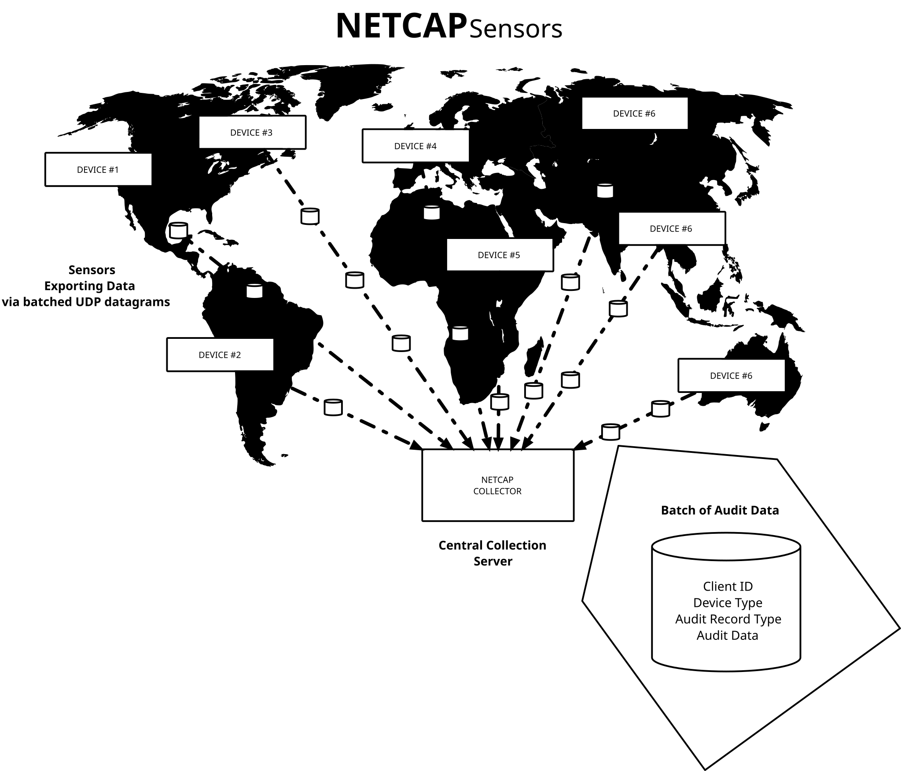

# Distributed collection

Sensor agents (`net agent`) capture live traffic and stream audit records to a central collection server (`net collect`). The collector writes one `.ncap.gz` file per agent and record type. Read the files with `net dump`.



A typical setup is a branch office with a sensor in the DMZ and one on the office LAN, both sending to a collector in the server room. Sensors still write some data locally: extracted files, logs and, if enabled, behavior state. Use `-fileStorage ''` to turn off file extraction. Behavior state lives under the OS user config directory in `netcap/behavior/<interface>/`. Set `-behavior-baseline` to change that location.

## Set up the collector and sensors

Generate the collector identity. The command prints the fingerprint that agents pin:

```
$ net collect -gen-keypair
wrote collector.crt and collector.key
server fingerprint (pass to agents as -server-fingerprint):
189b77182bb198ad6f2bf10d672eb4c6ad5b94a34b5d6b4bb861ccfde290abc1
```

On each sensor, generate an agent identity:

```
$ net agent -gen-keypair
wrote agent.crt and agent.key
agent fingerprint (add to the collector's -clients file):
b69d2c0a5cac19c3351d422d43ba2b029a91ecdab83fdf3fd2de3716a4039236 <name>
```

Add every agent to the collector's allowlist, one `<fingerprint> <name>` per line. A name is 1-64 characters from `[A-Za-z0-9._-]`. The collector refuses to start if a line is malformed or a key or name appears twice.

```
# clients.txt
b69d2c0a5cac19c3351d422d43ba2b029a91ecdab83fdf3fd2de3716a4039236 sensor-dmz
<fingerprint of the LAN sensor> sensor-lan
```

Start the collector, then each sensor. Set `COLLECTOR_FINGERPRINT` to the full 64-character fingerprint the collector printed. Shortened fingerprints are rejected.

```bash
net collect -clients clients.txt -addr 0.0.0.0:1335 -out collected
net agent -server-fingerprint "$COLLECTOR_FINGERPRINT" -addr collector:1335 -iface eth0
```

Records land in `<out>/<name>/<Type>.ncap.gz`, for example `collected/sensor-dmz/TCP.ncap.gz`:

```bash
net dump -read collected/sensor-dmz/TCP.ncap.gz -table
```

Directories are created with mode `0750` and files with `0640`. If a file from an earlier run exists, the collector writes the next one as `TCP-1.ncap.gz` and so on. Key files are written with `0600`, and `-gen-keypair` will not overwrite them.

To revoke an agent, delete its line from the allowlist and restart the collector.

## Transport and authentication

|                 |                                                                                                                  |
| --------------- | ---------------------------------------------------------------------------------------------------------------- |
| transport       | TCP, TLS 1.3 only                                                                                                |
| authentication  | mutual; both sides present a self-signed Ed25519 certificate                                                     |
| trust           | SHA-256 of the peer's public key (SPKI), pinned like SSH `known_hosts`; no CA                                    |
| client identity | the name in the collector's allowlist for that key; the agent cannot choose its identity or its output directory |
| delivery        | every batch is acknowledged after it is written; the agent resends unacknowledged batches after reconnecting     |

After the handshake, each frame is `[1 byte type][4 byte big-endian length][payload]`. The length is capped at 4 MiB by default (`-max-frame`) and checked before any memory is allocated.

| frame | direction         | payload                                                             |
| ----- | ----------------- | ------------------------------------------------------------------- |
| Hello | agent → collector | protocol version, capture source, session id                        |
| Batch | agent → collector | record type, sequence number, concatenated length-delimited records |
| Ack   | collector → agent | 8-byte sequence number                                              |
| Error | collector → agent | reason; the agent drops the rejected batch                          |

The collector parses every record in a batch before writing it. If a batch fails to parse, the collector answers with an Error frame and writes nothing. If a local write fails, it closes the connection without an Error frame, so the agent keeps the batch and resends it.

## Agent flags

| flag                      | default |                                                                                                                                     |
| ------------------------- | ------- | ----------------------------------------------------------------------------------------------------------------------------------- |
| `-max`                    | 1 MiB   | target batch size; a single larger record is sent alone                                                                             |
| `-flush-interval`         | 5s      | send a partly filled batch at least this often, so rare record types still arrive                                                   |
| `-max-pending`            | 64 MiB  | unacknowledged batches kept in memory while the collector is unreachable; beyond this the oldest are dropped and the drop is logged |
| `-shutdown-timeout`       | 30s     | how long SIGINT/SIGTERM keeps delivering queued batches                                                                             |
| `-reassemble-connections` | true    | required for every stream decoder (HTTP, SMTP, ...)                                                                                 |

Reconnects use exponential backoff from 1s to 60s. On exit the agent logs how many batches were delivered, rejected, dropped and left undelivered.

## Collector flags

| flag                | default     |                                                                       |
| ------------------- | ----------- | --------------------------------------------------------------------- |
| `-out`              | `collected` | output root                                                           |
| `-max-frame`        | 4 MiB       | largest accepted frame                                                |
| `-max-conns`        | 256         | concurrent connections                                                |
| `-idle-timeout`     | 5m          | close a silent connection; the agent reconnects when it has more data |
| `-shutdown-timeout` | 30s         | wait for in-flight batches before closing files                       |

## Limits

* A record larger than about 4 MiB cannot be sent. The agent drops it and logs it.
* The agent keeps its resend queue in memory. If the agent process dies, queued batches are lost.
* The collector acknowledges a batch once it is gzip-flushed to the OS, before fsync. If the collector host crashes, acknowledged batches can be lost.
* A file the collector is still writing is an unfinished gzip stream. Reading it before the collector shuts down ends with `unexpected EOF`.
